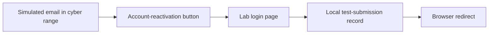
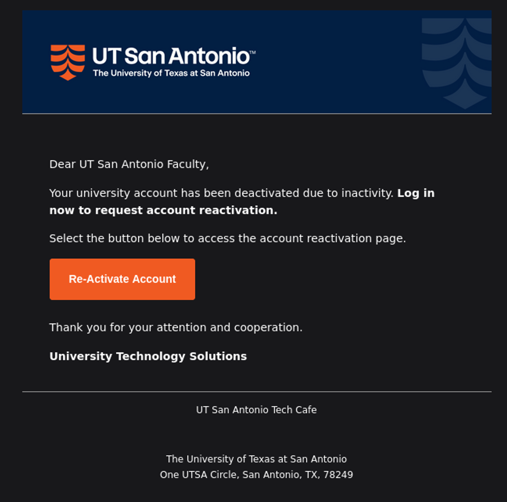
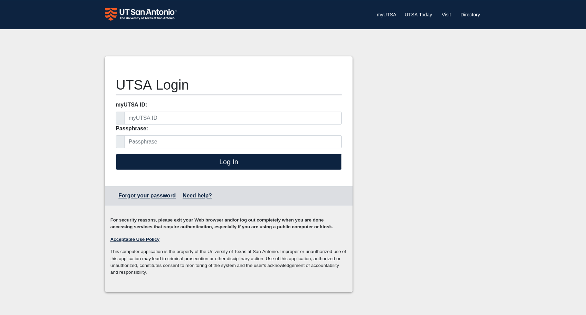
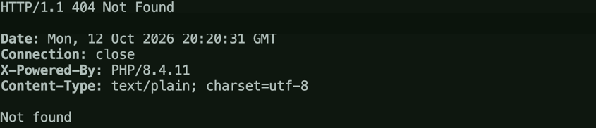

# Social Engineering Simulation and Defensive Analysis

An authorized graduate cybersecurity lab demonstrating how a simulated phishing email, a replica login interface, and an HTTP server interact—and how defenders can investigate that activity.

## Overview

I completed this exercise in an isolated university cyber range. The assignment involved creating a simulated account-reactivation email, hosting a lab login page, recording instructor-provided test submissions, and redirecting the browser after submission.

All simulation emails were sent through the assigned range mail server. The receiving account and test interactions were designated by the course.

This public write-up omits captured credentials, personal identifiers, and operational credential-capture code.

## Tools and Technologies

- Kali Linux
- Thunderbird with IMAP and SMTP
- HTML and CSS
- PHP
- systemd
- DNS utilities: `dig` and `getent`
- HTTP testing with `curl`
- Linux file permissions and service logs

## Lab Architecture

The web server ran on the assigned Kali VM. A lab hostname resolved to that VM, and a background service kept the server independent of an SSH session. Submission records were stored outside the public web directory.

## Implementation

### Email Configuration and Testing

I configured the assigned range mailbox in Thunderbird and verified delivery by sending messages to myself.

I created a separate simulated sender identity while retaining the assigned account for SMTP authentication. Self-testing confirmed the visible sender identity, subject, formatting, and link destination.

The HTML email used an account-deactivation scenario and a labeled reactivation button. I adjusted its button color after discovering that the initial navy background blended into Thunderbird's dark mode.

### Login Interface

I adapted a reference login layout for the lab environment. The page included locally served stylesheets and logo assets, labeled username and passphrase fields, and a login button.

I removed the production authentication token and scripts and connected the form to the lab endpoint.

### Submission Handling

The backend checked that both submitted fields were nonempty strings. It appended each test submission with a UTC timestamp to a local record file, then issued an HTTP 303 redirect.

Appending preserved earlier records. File locking protected against overlapping writes.

In this controlled exercise, the record contained the instructor's supplied test values. Storing plaintext passwords would be inappropriate in a production authentication system.

### Service and File Protection

I configured a systemd service to run the server as an unprivileged user with the capability needed to bind HTTP port 80.

The service was configured to restart after failure and start automatically. Status checks and HTTP requests verified operation at the times tested.

The record directory remained outside the public document root, with restrictive directory and file permissions. An explicit router returned HTTP 404 for unrecognized paths.

## Troubleshooting

| Issue | Investigation and resolution | Lesson |
|---|---|---|
| Initial hostname lookup returned an unexpected IPv6 result | Checked the IPv4 A record separately and verified browser access | Distinguish DNS record types before diagnosing a connectivity failure |
| Recording failed after switching to the background service | Corrected the log's ownership and permissions for the service account | Check the effective user and file permissions |
| A nonexistent record-file URL returned HTTP 200 | Identified PHP's index-page fallback and added explicit routing | A status code alone does not establish what content was returned |
| Package installation waited after SSH disconnected | Identified a configuration prompt associated with the previous terminal and resumed configuration | Diagnose package-manager state before removing locks or terminating processes |
| Email banner disappeared behind a privacy warning | Identified remote-content blocking in Thunderbird | Image visibility depends on mail-client policy |
| Button blended into dark mode | Changed the button styling and repeated the self-test | Verify rendering in the actual receiving client |

## Validation and Results

I verified:

- IPv4 resolution of the assigned lab hostname.
- Self-addressed email delivery.
- The simulated sender identity in the received message.
- The email button's destination.
- The login page's appearance and locally served assets.
- Recording of dummy submissions and subsequent redirection.
- An active web service and HTTP 200 response.
- HTTP 404 for the attempted record-file URL.

The log later contained two instructor submission events with one unique test credential pair. Those values are intentionally omitted from this repository.

The final email retained a remotely hosted banner, which could be blocked by the recipient's mail client. Service status checks provided evidence of operation at specific times rather than independent proof of uninterrupted availability.

## Defensive Analysis

The points below describe possible defensive checks, not detections I implemented during this lab.

### Email Triage

This exercise illustrates why analysts should inspect more than a sender's display name.

Useful checks include:

- The actual From address and domain.
- Whether the message's request fits the organization's normal workflow.
- The destination behind a button or descriptive link.
- Message headers and authentication results, when available.
- Urgency or account-access claims that encourage immediate action.

The simulation demonstrated that a visually branded message can still direct a recipient to an unexpected destination.

### Network and Web Investigation

A defender could examine DNS queries, HTTP requests, and proxy or endpoint telemetry for visits to a suspected replica site.

Relevant questions include:

- Which hostname and IP address did the browser contact?
- Was the connection HTTP or HTTPS?
- Did the browser submit a form to that destination?
- Was the submission followed by a redirect?
- Did the destination match an approved authentication service?

Redirecting to a legitimate website after submission does not make the preceding interaction legitimate.

### Authentication Controls

Production authentication systems should avoid plaintext password logging and use appropriate password hashing and access controls. Organizations can also reduce phishing exposure through phishing-resistant MFA, established account-recovery procedures, and user reporting channels.

## What I Learned

This lab strengthened my ability to connect DNS resolution, HTTP behavior, email configuration, Linux permissions, and background-service operation into one workflow.

The most useful troubleshooting lesson was to verify each stage independently. A page loading successfully did not prove that it could record a submission, and an HTTP 200 response did not prove that the requested file existed.

For SOC work, the exercise reinforced the importance of analyzing sender identity, link destinations, browser activity, and redirects together rather than relying on visual appearance alone.

## Screenshots

These screenshots were extracted from my course report. Email headers, browser address bars, and identifying terminal details were cropped or redacted. Captured credentials are not included.

### Simulated Email

The self-test message rendered with university-style branding and a visible action button. This image shows the message body; the sender and recipient headers have been removed.

### Lab Login Interface

The lab page used locally served design assets. The browser address bar has been removed.

### Web Service Status

The service was enabled and active at the time of the check. Request logs and identifying terminal details have been removed.

### Record Path Protection

The record-file URL returned HTTP 404. The hostname and terminal command have been removed.

## AI Assistance

I used ChatGPT/Codex to help interpret the assignment, draft HTML and PHP, troubleshoot configuration issues, and organize documentation.

I executed the lab steps and verified the guidance through email self-tests, browser submissions, record inspection, service status checks, and HTTP requests. AI also assisted with drafting this case study.
